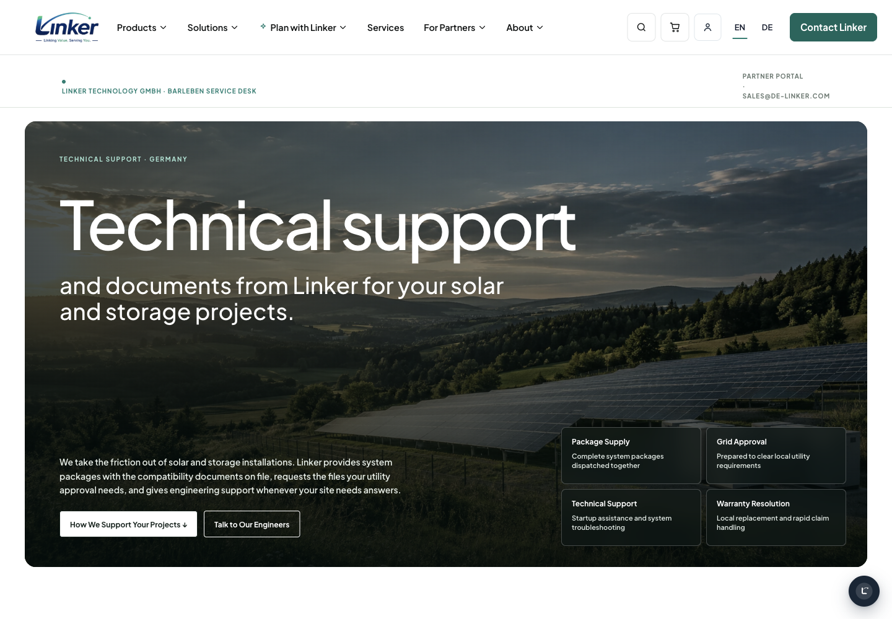

# PR #316 second-review acceptance

Source/application and reviewed data: `bd862bdd5253ed246ab0fa5267f2b5defd6a8c4c`. Fixed main: `1a277c1e51e3f6acb04771a3277b7960f2f36d3b`. Later delivery commits contain evidence only; executable files are checked byte-identical. This is the validation cutoff. Earlier packages keep their actual source pins.

## Six review items

| Claude item | Completed result | Actual evidence |
|---|---|---|
| 1. Account endpoint hreflang / strict audit | All 12 changed account rows, 10 destinations, have German alternate = canonical = final endpoint URL. EN/x-default retain the corresponding native Woo endpoint. Audit also rejects missing metadata outside the nine explicitly retained native paged omissions. | [Failing public HTTP test](hreflang-red.xml), [passing targeted test](hreflang-green.xml), [category red](category-metadata-red.xml), [metadata green](metadata-green.xml), [negative-control audit](audit-negative.json), [complete HTTP readback](route-results.json). |
| 2. Polylang access | GermanRoutes, GermanTitles, GermanUrlMigration and JournalTitles use the existing Languages facade. | Full-diff independent [review](../review.md), [legacy/boundary readback](legacy-absence.json), source and complete real suites below. |
| 3. Service evidence | Historical desktop before/final images are identical and prove retention, not a desktop redesign. The ledger is corrected. A separate new owner-reported hero overlap has fresh before/after captures and regression tests. | [Historical pair disclosure](service-evidence.json), [actual pre-fix capture](service-before.json), [current four-state readback](service-readback.json), [owner screenshot](owner-service-hero-feedback.png), [change ledger](../change-ledger.md). |
| 4. Inquiry receipt mail | Native InquiryReceivedEmail generates a valid German registration claim; one tester-only MIME is captured locally, with native key/id and prefilled email checked over HTTP. Queue data proves the original routing; language/options/tasks/files are restored. | [Final mail](mail/inquiry-received.eml), [queue](mail/inquiry-received-queue.json), [targeted green](receipt-green.xml). The two earlier receipt-fixture red records are rejected harness runs, not passing delivery evidence. |
| 5. Journal geometry | Named WindPress tokens retain approved 224/220/280/104/80/28/19px values; existing colors, type hierarchy, sidebar inset and mobile behavior are preserved. | [Native computed geometry and capture readiness](visual-readback.json), [honest pixel readback and remaining gate](pixels/README.md), [native catalog regeneration](catalog-regeneration.log). |
| 6. Reviewed titles | Runtime and migration share content/german-titles.json as their sole seven-object title/name source. Endpoint gettext remains native. | Full source review, repeated real migration/title tests and [full title table](completion.md). |

## Completed checks

- [just check](just-check.log) and [just test](just-test.log): exit 0 on the frozen current source. Their default integration skips are not accepted as live-fixture evidence.
- Explicit German URL/title suites: **33 tests / 35,728 assertions twice**, zero failures/errors/warnings/skips: [run 1](integration-1.xml), [run 2](integration-2.xml).
- Explicit inquiry/reader suites: **24 tests / 197 assertions twice**, zero failures/errors/warnings/skips: [run 1](inquiry-reader-1.xml), [run 2](inquiry-reader-2.xml).
- [Public browser regression](service-header-green.json): **36/36 passed, no skips/flaky results**. It includes EN/DE service hero at six widths and all three existing header engines. The [actual initial service red](service-hero-red.json) was 8 failed / 4 passed. The ruled Firefox 1283–1287 difference is retained exactly; no xfail/skip masks it. Concurrent preliminary reads during migration rollback were rejected and are not counted.
- [Full route table](completion.md): **184 reviewed rows, 97 direct first-hop 301s, 175 distinct canonical titles, zero defects**. Native logout retains its Woo 302 transition. Native sitemap: **DE149 / EN148**, English path set unchanged. The automated title test checks presence, uniqueness and the defined banned terms; German wording is reviewed through the existing [copy review](../copy-review.md), not asserted by a language detector.
- [Negative control](audit-negative.json): deliberately wrong account alternate plus missing documents canonical/hreflang cause the public audit to return nonzero. Temporary local-only filters affect only this run’s unique authenticated fixture and are removed in finally before the complete positive readback; other sessions are unaffected. This operational control runner is serial: do not run two copies concurrently against c254 because the fault MU filename is fixed.
- [Catalog preservation](catalog-preservation.json): all pre-existing main German msgstrs retained. Commerce has 835 active entries vs main836; the retired English source “Sign in or register” and its unchanged German translation remain obsolete in PO. Tools453/453, i18n28 existing retained within45 active. No existing translation is lost or changed; generated catalogs use native tools.

## Visual readback

Native `present`, then WindPress Settings → Performance → Generate compiled the actual served CSS. Twelve current-source EN/DE × 1440/390 frames cover service, journal and inquiry, with fonts and visible images ready and no document overflow. Journal desktop remains 224px with equal 17px selected-link insets and the approved subtle background. Inquiry consent remains flex/12px/400/0px. Service proof cards are two by two on desktop; native links remain usable. [All metrics](visual-readback.json).

- [EN service desktop](service-en-1440.png), [DE service desktop](service-de-1440.png), [EN service mobile](service-en-390.png), [DE service mobile](service-de-390.png).
- [EN journal desktop](journal-en-1440.png), [DE journal desktop](journal-de-1440.png), [EN journal mobile](journal-en-390.png), [DE journal mobile](journal-de-390.png).
- [EN inquiry desktop](inquiry-en-1440.png), [DE inquiry desktop](inquiry-de-1440.png), [EN inquiry mobile](inquiry-en-390.png), [DE inquiry mobile](inquiry-de-390.png).

The new [18 whole-page English pixel comparisons](pixels/results.json) compare fresh current native PNGs against the immutable accepted EN frames at source `aa552bdf`. The exact original viewports (1440×900 / 390×844), same IAB/CDP capture protocol, eager decoded images/fonts, paused loaded first video frame and no preparatory scrolling are retained. The [capture manifest](pixels/capture.json) records both source stages; [recompare.py](pixels/recompare.py) replays the shared `tests/visual/compare.py` against unchanged raw inputs. No shared worktree source or database is switched while the other session remains active. **9 comparisons have zero RGB differences; 9 have nonzero differences. The comparator returned exit1.** No masks, cropping, tolerance or ruled regions were used. The older baseline predates main’s native create-account additions; current-source strict parity against the fixed latest-main baseline is **not proven**. Small logo/footer differences also remain in the raw report without an inferred waiver. These are local regression captures, not live-production captures. [Exact counts and scope](pixels/README.md).

The historical [full feature/main English pixel report](../pixel-results.json) remains pinned to actual main `1f271843` / source `aa552bdf`: 18 unaffected EN comparisons at zero pixels. It is not relabelled as new. The new service hero repair is an explicit owner-authorized exception with its own true before/after evidence. [Source delta and scope](source-delta.json).

## State and handoff

[Final native CLI readback](migration-final-state.txt): dry run zero changes, migration verify and presentation check pass. [Final instance state](instance-final-state.json): no fixtures owned by this run and no temporary fault MU; another active session’s existing i254-visual fixture is preserved, no test-mail override; SQL/cache ACTIVE agree and the original 77-object backup remains. Fixture data/options/tasks and local mail files restore themselves between runs. The existing shared-session fixture is explicitly disclosed and is not deleted by this run.

[Verification](verification.json) records actual counts/timings and provenance. Independent Spec/Standards conclusions are in [review.md](../review.md). Application CI is confirmed on the merged PR #316 source. Another active session merged that PR while this implementation session was still completing acceptance; this session did not merge or deploy. The final supplementary evidence commit requires an explicit workflow_dispatch run. Its exact SHA/result will be recorded in the final PR handoff comment after that run completes; application CI is not a substitute for this branch check.

Only **c254 http://127.0.0.1:9129** was used for ticket development/acceptance. Snapshot **20261019-0102**, taken **2026-10-18T17:10:18Z**, loaded **2026-10-18T17:12:26Z**. The interrupted preceding-snapshot run is disclosed separately in interrupted-run.json. The main checkout was not edited. This session performed no merge, deployment, production write or real mail. The remaining fresh strict pixel gate is explicitly open; local/CI success does not close it. Claude's [production runbook](../production.md) specifies full backup, presentation-backup export, dry run first, repeatable migration, native publication/cache, readback and rollback.
