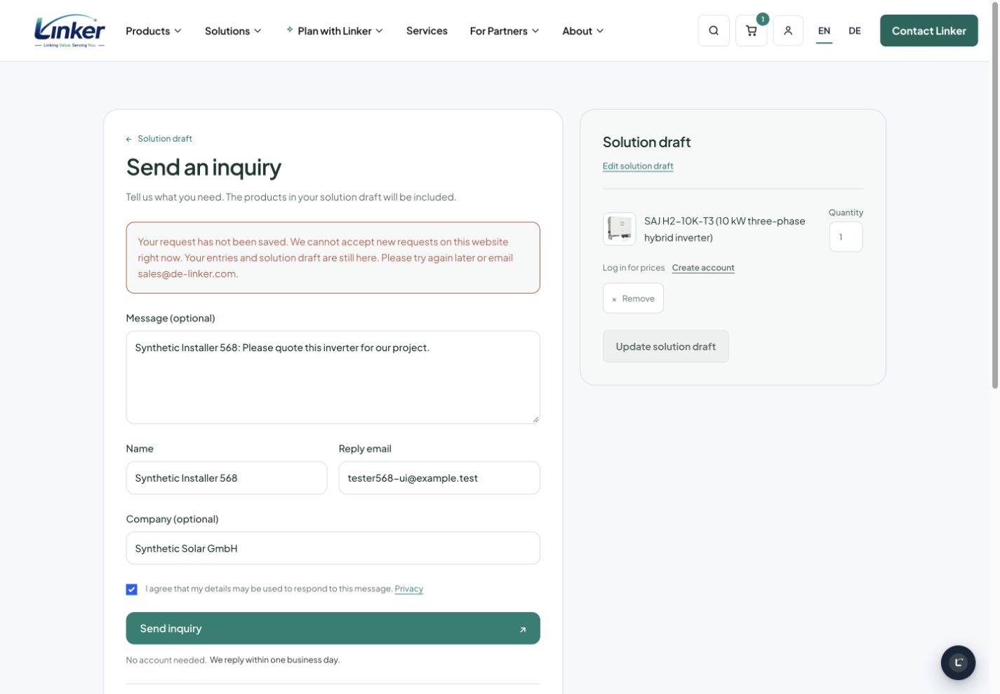
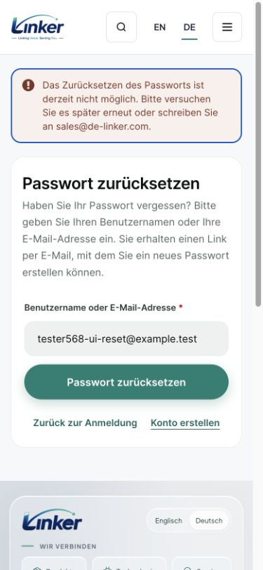

# Business reception and notification capacity acceptance (#568)

**Historical candidate evidence:** the records below are from the original #568
candidate, not the current protected-base integration. Its original advisory
mail policy is superseded by the mandatory pre-send owner decision. See
[current integration](current-integration.md) for the new composition and gates.

This is implementation evidence from the exclusive `b568` native WordPress /
WooCommerce instance, loaded from the online snapshot before UI work. It is not
a production release or real inbox claim. The coordinator owns the combined
release, fresh backup, full-diff Spec and Standards review and live readback.

## Result and limits

Ordinary verified business reception now shares a site throughput and persistent
unhandled-data envelope across all five actions. A real staff-approved customer
has a separate reserve. The last native JobStore writer bounds ordinary and
critical notification jobs, including reserved space; accepted inquiry sources
remain recoverable when notification handoff fails. The original candidate
treated Jev as advisory; current integration does not retain that delivery policy.

The operating values and honest full-capacity behavior are in the
[specification](../../../specs/568-global-business-intake.md). These are adjustable
allocations, not measured customer peaks. Full capacity can temporarily prevent
a real new submission. Existing native inquiries and the original held mail are
not deleted, automatically refunded or sent by this implementation.

| Evidence | Native result | Concrete consumer boundary |
| --- | --- | --- |
| `GlobalBusinessCapacityTest`, `BusinessAdmissionTest`, `PublicSubmissionTest` | Included in 233 tests / 3,166 assertions | Five shared site actions; identity rotation; trust provenance; complete prepared bytes and legal large drafts; first native writer; approved reserve; two-connection final-slot races; draft retention |
| `SummaryEnvelopeTest`, `SafeIntakeTest` | Included in the same native run | Existing summary retained; complete base plus schema-derived envelope before paid work; no site mutex during provider work; saved source recovery versus genuinely unknown pre-save work |
| `MailCapacityTest`, `CriticalNotificationCapacityTest` | Included in the same native run | Final job count/bytes; critical reservation consumption; ordinary full leaves critical space; immutable native approval; reset before key mutation; Proforma source recovery; held promotion; outer rollback has zero transport |
| `AtomicMailConnectionTest`, business/account KILL cases | Included in the same native run | Real second-connection KILL before first native write and after partial writes; original-client fencing; commit-unknown does not invent rollback; original job plus AS survives post-commit SIGKILL |
| `VatNotificationCapacityTest` | Included in the same native run | Latest native VAT verdict version survives full queue, exact-generation ACK, repeated recovery, edit race, erase/delete |
| `ConversationConfirmationCapacityTest` | Included in the same native run | Exact native confirmation token to one durable original job/ACK; two real workers; full retains retry; erased/expired/foreign source; caller transaction rollback |
| `BusinessDispositionTest` | Included in the same native run | Guarded historical note/body/marker authority, invalidation returns debt, old registry restoration, exact rollback, no mail |
| `ConversationRoutesTest` (Tools native) | 9 tests / 87 assertions | Real route callers preserve failure/retry and existing normal bool contract |
| Commerce unit suite | 1,601 tests / 6,139 assertions; 358 native tests skipped by the unit bootstrap | All unit assertions pass; the relevant 233 native cases above were executed separately, not all 358 native cases in this plugin |
| Tools affected unit suite | 6 tests / 37 assertions | Bounded internal summary diagnostic; existing customer content remains unchanged |
| Commerce / Tools PHPStan and owned-file WPCS | Pass | Commerce whole PHPStan, Tools whole PHPStan with 2 GiB analysis memory; 89 Commerce PHP files and four Tools PHP files follow native standards |

The expanded native run is `review-native-final11.txt`; final Commerce unit/style
analysis logs are `review-unit-final11.txt`, `review-phpcs-final11.txt` and
`review-phpstan-final11.txt`. Full-base Commerce style was rechecked in `review-phpcs-full12.txt`; unchanged
Tools logs remain `phpstan-tools-final12.txt` and
`phpcs-tools-final12.txt`. These sanitized logs,
failure reproductions and private snapshot/rehearsal artifacts are held locally
under `/Users/chesterjohn/de-linker-data/incident-20261022/intake-568/` with private
permissions. No business text or credentials are included in this public record.

The [review repair record](review-repairs.md) traces the fixed-source five native
consumer defects, original critical-mail CI failures, actual in-progress retry
seam and separate fixture lifecycle/history corrections. The general job in
workflow `39815794782` passed; its native-mail job failed before these repairs.
A fresh exact-head workflow is required. No production success is inferred.

## Rendered native forms

The [28 screenshot manifest](screenshots.json) records actual JPEG MIME,
dimensions and SHA256 of unchanged CUA screenshot bytes. The requested viewports
were 1440×1000 and 390×844; the browser excludes its scrollbar from some image
captures. Files use `.jpg`, including older captures whose first temporary
filename used `.png` despite JPEG bytes. No image was transcoded.

- Contact and inquiry: EN/DE × desktop/mobile × normal/full, 16 captures. Four
  successful synthetic inquiries had received status, expected source and native
  notification jobs. They were removed only from this disposable local fixture.
  Those views preceded the later connection-fencing change, which does not change
  presentation; the final native suite covers the updated writers.
- Inquiry consent recovery: EN/DE × desktop/mobile, four additional captures after
  the narrow native form fix. Actual full POST preserves the original message,
  name, email, company, product 4107 at quantity one and consent `1`. A fresh form,
  `0` or an unexpected value does not receive automatic consent.
- Password reset: EN/DE × desktop/mobile × failed/accepted handoff, eight captures.
  Failed actual JobStore creation leads to a 303 back to the same native form,
  with the reviewed unavailable notice and editable email retained. It does not
  reach `reset-link-sent`. Accepted handoff follows the existing Woo confirmation
  page only after native key, original job and recovery action commit.

All local SMTP was prevented using the native full throttle, and all server HTTP
was blocked by an exclusive disposable MU fixture. The accepted reset readback
contains two critical jobs, each with attempts `0` and its original scheduled
recovery action. Native reset key existence was read only as a boolean, never
printed. Full business POSTs created zero records. Exact synthetic records/jobs,
the MU fixture and native quota options were cleaned up/restored afterward.

The UI fixture seeded a valid native ledger proof only for the exact synthetic
POST, and omitted the public protection script only in that local fixture. Thus
these screenshots prove native capacity, retained input and recovery rendering,
not a live Turnstile challenge. Combined EN/DE reset scenarios reached the existing
two-per-target hourly policy; the exclusive local ledger was reset before normal
visual scenarios. Existing rate enforcement is covered by native tests, not by
claiming unlimited immediate password-reset retries.

## Historical debt, migration and release

The private unmodified 14:08:10 UTC snapshot measured ordinary debt at 102 /
394,625 complete logical bytes, separate review debt at 3 / 6,931 bytes, and 38
held jobs / 438,262 bytes at attempt zero. This snapshot is stale for release:
the coordinator observed a later, separate 24-message campaign. Nothing in this
ticket silently expands the fixed original 87-body disposition manifest.

On a disposable native clone only, the exact manifest applied 87 employee
dispositions, read capacity in a fresh PHP process, and rolled all 87 back. The
remaining 15 records are unknown, not asserted real or trusted. The original
38-job metadata/status hash stayed unchanged. The guarded script and rollback
contract are described in the [specification](../../../specs/568-global-business-intake.md).
Production application requires the coordinator's fresh complete backup and actual
current count/byte readback, including any new attack debt; no worker production
write has occurred.

## Explicit exceptions and remaining release gates

The core gateway-enabled post-write notification has no reliable native original
event source. Full capacity returns false and a bounded health result; it is not
claimed automatically reconstructible. Digest/health rebuild current state on a
later tick. VAT preserves only the latest native review state, not every historic
event. Registration pending-account capacity and its two native notice producers
are owned by #569 and must be integrated without replacing this single shared mail
capacity implementation.

CI, full-diff independent reviews, integration with the latest protected main and
#569, production backup/guarded historical disposition, exact installed-source
readback and authorized real customer/inbox acceptance remain coordinator gates.
This report does not mark them complete.
