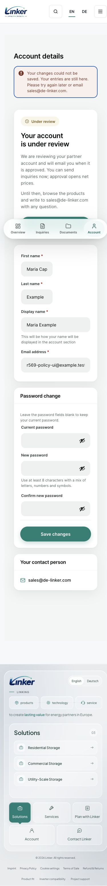

# #569 本地原生验收

本票工作树 `codex/569-registration-capacity`；本地 `r569` 使用完整线上主题/uploads/内容快照，WordPress9338、engine9339、Genie9340。此次验收没有部署、合并、生产写入、真实模型调用或外部邮件投递。四模型路由和原生权限边界未改。完整全量 diff 的 Spec / Standards 评审由协调者在固定 head 上安排。

实现合同见 [spec](../../../specs/569-registration-capacity.md)，客户及员工文案的初稿→对抗意见→定稿见 [copy review](copy-review.md)。原始 Message、邮箱路由、nonce、operation/receipt、trace、SQL故障输出和本地HTTP fixture 均仅保留在本机私密 `incident-20261022/registration-capacity-569`，不进仓库。

## 故障的红绿证据

| 原生层问题 | 反馈门与结果 |
|---|---|
| 公开入口原先只有 subject/connection，没有 site 注册窗口 | 原生 Ledger/Proof/Operation 站级断言先红；现在16/hour、32/UTCday跨廉价身份共享，UUID异body不借用准入 |
| 未接通 pre-create count/bytes + 两 notice | 真实 Woo validation → native wc_create_new_customer → metadata/user_register → VAT → Outbox，容量满在第一笔 user/VIES/mail 前拒绝；原生 slots 与最终账户替换读回 |
| 猜测邮件256KiB界值、ID0预览不足 | 完整配置 Message 冻结，EN/DE × 两 producer × 3个ID × 5个VAT label逐项核完整JSON；长业务值完整保存，override破坏受控洞明确拒收 |
| Woo billing handler 不捕获 customer->save 异常 | 真实 WC_Form_Handler::save_address 红门→原生 validation seam正常 notice，输入保留且原生公司资料未变 |
| Woo account details 先 wp_update_user 后 customer->save | 真实 handler 锁住 partial core first_name 红门；跨两个 native writer 的原事务范围后通过 |
| account details 错误页面只重读原用户，丢失拒绝输入 | 实际 account WP_Query + AuthTemplates 选中项目模板，撤四 value 供给时红；恢复后同次 owner/nonce/action 的 canonical四字段保留，密码和跨用户不借用 |
| skipped notice 取消容量后 source ACK 失败留下悬挂引用 | 原生写失败红门→取消与 source ACK 同事务，恢复只取消未进入 JobStore 的本 notice，两个 count1 独立 |
| privacy 删 job 成功而 source ACK 失败 | 真实 source写失败红门→两个原 job/AS/容量/source同事务回滚；另一连接持有任一 job 时两者均保留 |
| 原 tx 中的 rollback 可以误伤外层无关修改 | native第二连接确认：失败仅回滚原 savepoint，外层数据仍未提交、对第二连接不可见，由原调用者决定提交 |
| wpdb2006断线重连 replay 导致部分 autocommit | 两个实际跨hook writer，首写前/第一写后各 KILL：撤本票 guard 的控制红复现用户、profile部分保存；追加断言捕获 user回滚但孤儿metadata重放。恢复 NativeTransaction 后四门通过 |
| 员工 audit→slot CAS、privacy job删除→source ACK 中途断线 | 实际独立连接 KILL；原生 audit/slot与两个job/source均保持原状态，不把新连接的COMMIT/ROLLBACK当成功 |
| source accepted已清payload，进程在即时dispatch前退出 | 复用中央 JobStore：同事务 original-job AS+readback；实际注册 producer 无自定义AS补丁，native Outbox hook合成transport只消费原job一次，重复hook和source恢复不再建job |
| COMMIT 已执行而 ACK 丢失 | native实际COMMIT后返回合成错误：注册账户保留且独立 minute recovery可接两notice；profile真实新值读回且用unknown文案，不假称未创建/未保存 |
| 创建进程被SIGKILL | 真正子进程暂停在native pre-create范围后被杀；未提交user/source/reservations回滚，已发生的public attempt不退款 |
| 最后一个 count / byte资源的竞争 | 两个真实原生进程争同一资源只一方建户/VIES/两job；待处理profile增长与新注册也共享同一串行点，失败方不等长锁 |

已有用户、默认 subscriber、无员工审计的 approved、限制、已登录、邮件送达、时间经过和模型结果均不释放待处理账户。真实员工 approved/rejected、原生删除重新核读释放。off/observe 路径保持原生行为。verified-email privacy 原始地址、改邮箱、native删除、busy/read/write失败与已擦除source不复活均有原生夹具。

注册满额的买家回归包含真实 WC_Cart 的产品125×2：拒绝后 hash保持，**同一browser**通过原生 Inquiry Handler 仍创建guest inquiry并包含两件产品。普通登录/重置/询盘不使用注册额度，没有让客户切身份或MFA。

一条历史 OpenInquiryTest 夹具原本期待 `/cart/` 的无class form；固定 `origin/main a0edc136` 已于 `a44a2a9f1` 使用 `Form::draft-action = wc_get_checkout_url()`。本地实际为带 `woocommerce-cart-form` 的 POST `/proforma-request/` 与隐藏 `proceed=1`。先保留失败输出，再将夹具改为解析唯一该form并断言 exact native checkout action/method/proceed；保留真实 inquiry admin-post transport，不放宽成任意路由。

## Computer Use 与图像真值

使用自有 Chrome tab329395461，未触碰根生产tab、MFA tab329395436或#568 tab。视口设置 desktop1440×1000、mobile390×844；read-only DOM逐图记录 innerWidth/innerHeight/clientWidth/scrollWidth/lang/url。滚动条占15px，截图内容区域实际宽1425/375。**字节实际是 JPEG/JFIF，扩展名为 `.jpg`、MIME image/jpeg；没有称作1440/390像素宽PNG，也未重编码原字节。** [四张公开图的原始尺寸、SHA256与viewport记录](screenshots.json)。

共34张本地截图：以下8个状态均EN/DE × desktop/mobile，另2张EN员工实际处置历史：

1. 注册第二步的原有表单；
2. 正常原生注册后保持登录、账户待审；
3. 业务字节容量满时注册拒绝，非密码值保留、密码空且有重新输入提示；
4. billing业务资料增长拒绝，输入保留；
5. account details增长拒绝，实际姓名输入保留而native DB原值不变；
6. 创建成功但通知pending，与独立receipt-policy skipped；
7. 原生员工恢复按钮后notification queue accepted；
8. native verified-email eraser注册的callback实际擦除source/job后后台erased状态。

下方公开图只有合成账户；完整员工屏和native回读保留在私密证据目录。

| | Desktop（内容1425px） | Mobile（内容375px） |
|---|---|---|
| EN account details拒绝 | [原图](en-1440-account-details-capacity-refusal.jpg) | [原图](en-390-account-details-capacity-refusal.jpg) |
| DE account details拒绝 | [原图](de-1440-account-details-capacity-refusal.jpg) | [原图](de-390-account-details-capacity-refusal.jpg) |



DE后台长恢复按钮最初出现横溢；独立copy审后只沿WP原生按钮缩短标签，最终两语言390的scrollWidth=clientWidth=375，没有CSS或PHP布局改动。客户页面同样无横溢。

本地HTTP fixture仅限精确r569 ABSPATH，siteverify/VIES/SDK使用合成返回，原生 prepare/verify/Proof/Ledger/Operation、users/meta、两邮件capture、JobStore及Action Scheduler不拦整route。五次公开注册operation来自同一browser：两个正常建户、两个容量拒收、一个receipt disabled建户。没有重置窗口或轮换身份追加注册。最后一个账户创建时发现的旧取消ACK缺口保留为真实红门；修法由新原生夹具验证，不把旧悬挂引用场景说成修后取消已完成。

擦除画面证明真实注册的native eraser callback及后续UI读回；没有发隐私确认邮件或伪称实走收件箱验证。UI状态图拍摄后收窄的是DB-only原连接与中央任务交接，定稿文案、模板value、布局和CSS未再变化；这些故障边界由最终原生夹具重跑。

## 本地清理与可复跑检查

自有tab已关闭、viewport reset；精确本地MU HTTP fixture已移除；receipt选项及原管理员locale已恢复。三名合成账户及其owned notices通过原生删除/隐私门清理，15个原有用户、13个pending、4029业务bytes恢复，interrupted/reserved bytes为0；public operation ledger保留原有五次消耗，没有额度reset。旧38条任务status+全部metadata SHA256逐一一致，未给它们补动作或清历史。

扩大原生套件曾出现第193ordinary被接受：新中央AS真实完成了本地填池fixture中的部分job，原生占用已减少，属于验收后台消费者竞争。Action Scheduler完成时间和原job ID已保存，独立容量门1test/156assertions通过；关闭自有admin心跳并隔离test-only async wake后复跑，绝不把合法消费误判成生产容量突破或放宽192/193断言。本地出现的EML均为本地capture，不是外部SMTP/收件箱投递；原38任务未变化。

检查命令：

```sh
PHPRC=/Users/chesterjohn/de-linker-local/r569/php.ini \
LINKER_WP_ROOT=/Users/chesterjohn/de-linker-local/r569/wordpress \
/opt/homebrew/opt/php@8.3/bin/php \
plugins/linker-commerce/vendor/bin/phpunit \
-c plugins/linker-commerce/phpunit.integration.xml.dist \
--filter 'RegistrationCapacityTest|MailCapacityTest|MailDispatchCapacityTest|ProtectionAccountsTest|RegistrationTest|ApprovalTest|PrivacyTest|BusinessAdmissionTest|ConnectionFenceTest|OpenInquiryTest|AtomicMailConnectionTest'

# plugins/linker-commerce
vendor/bin/phpunit
vendor/bin/phpstan analyse --no-progress --memory-limit=1G
# WPCS：本票18个PHP文件；共享API固定提交另有原生/静态证据。

# repo
just i18n-coverage
just i18n-validity

# plugins/linker-tools
npm ci --ignore-scripts
npm run build
npm run build:check
npm run lint:types
```

首轮功能固定提交：`ca1b46901dc57e26ff4e0eacb3cebe59c961ac48`。下列首轮检查与此版本对应；其后全量独立评审确实发现五项遗漏，修复和最新检查见文末，不能用首轮绿门替代修复后的复审。

首轮检查：

| 检查 | 结果 |
|---|---|
| 上述11组原生相关套件 | **121 tests / 2321 assertions，PASS** |
| commerce完整unit命令 | **1584 tests / 6139 assertions，353 native-only skips，无错误** |
| commerce全量PHPStan level8 | PASS，未加ignore或baseline |
| 本票18个PHP文件WPCS | PASS |
| i18n coverage / validity | gap0；8 catalogs PASS |
| tools build / build:check / TypeScript | PASS；工具源码/构建产物无diff |
| diff whitespace / 新文件旧标识符检查 | PASS |

本地build有既有bundle-size/performance建议，构建成功且build/source匹配，未改工具源码或构建产物。代码可回滚，持久pending source不应通过旧代码回滚而被遗忘：发布/回退时保留这些原生元数据、capacity及AS原job，先检查pending并由协调者决定兼容恢复版本；不能清空队列、历史、用户或额度作回滚。生产安装后的原生入站/组合/读回仍归协调者，本地验收不代表已上线。

## 全量评审后的五项修复

独立 Spec 在 `cf673e1d` 全量 diff 发现3项P2；独立 Standards 发现2项P1。本段记录修复及原生反证，**不把作者验证写成独立复审通过**。完整复审仍比较 `1f0547574a1a2582cf3ded2f6bf807dfc7284ea4` 到新的固定 head。先以固定提交 `654d4f38` 接入共享 `fc02979a`（NativeTransaction owned-start清理/commit结束确认及实际SIGKILL原任务恢复），没有复制其它工作树的未提交API。

| 评审遗漏 | 修前原生红门 | 修法与修后见证 |
|---|---|---|
| 客户回执政策绑定当前邮箱，冻结通知仍发原地址 | 政策已完成、JobStore/source ACK失败后改邮箱，恢复一直pending | 政策取冻结Message实际To；原生A→B后仍只接收To A，政策receipt和所有bucket均不变，不重定向B |
| 创建末尾void finish忽略非抛异常的completion错误 | 将最后Ledger写替换为原生无更新结果，账户仍被提交 | 直接检查Admission::complete；失败走原创建事务回滚/未知提示，无用户、job或占位被确认提交 |
| 原地址OWNER查询失败被当作空集 | A→B后合成原生SELECT失败，export空完成/erase称done | 不缓存失败的空结果；export返回WP_Error，erase retained且done=false，source不变；撤故障后原地址可读回并擦除 |
| REST路径猜测与原生匹配/写入target不一致 | 大小写原生route和body id覆盖route id时，第2字节仍写入 | 识别实际matched Users controller回调及其parsed id；真实dispatch最后1byte正常200，再增长1byte503，原值和8MiB占用保持 |
| 首次policy-skip整份source在原连接范围外写入 | 真KILL旧writer，独立PHP执行native erase；旧SQL重放复活另一notice的parts | 重新取得原生owner锁，在NativeTransaction内重读exact source才作skip/accepted/cancel/erase；真实断线和同连接健康stale两门都拒绝复活，recovery后仍erased |

冻结To去重、按规范地址稳定排序后，所有目标hour/day allowance和一次site/day在**同一Ledger reserve**提交；target full或site full均不产生半份扣款。原生夹具证明多To顺序/重复幂等、site只计一次、最后一次site额度成功及下一次整笔拒绝。原有string调用与规范化单To的operation ID/fingerprint、receipt和bucket字节兼容。保留Ledger既有16维输入界：每目标2维加site1维，至多7个唯一目标；超出或地址无法解析时保留通知pending/unavailable、不扣款、不裁剪To，也不拒绝已准入的注册。

新的隐私读取失败EN/DE定稿及独立copy意见见 [copy review](copy-review.md)。本机原生gettext读回EN源句和DE定稿正确；该新增浏览器错误状态未另做CUA截图。既有34张JPEG只证明上文所列客户/员工状态，本轮未改模板、CSS、前端源码或构建产物；不把旧截图说成这五项故障的浏览器证据。

第一轮修复检查（PHP8.3，子进程继承本次命令的PHPRC）：

| 检查 | 结果 |
|---|---|
| 上述11组原生相关套件 | **132 tests / 2473 assertions，PASS** |
| commerce完整unit命令 | **1595 tests / 6139 assertions，362 native-only skips，无错误** |
| commerce全量PHPStan level8 | PASS，未增加ignore或baseline |
| 本轮7个PHP文件WPCS（含原生测试和独立erase worker） | PASS |
| i18n coverage / validity / 原生gettext | gap0；8 catalogs PASS；新EN/DE句读回正确 |
| diff whitespace | PASS |

首次扩大套件中共享SIGKILL门失败，原因是父进程 `-c` 不传给子进程；子进程未继承实例配置。未修改业务或断言，命令级PHPRC及明确PHP8.3下该门先1test/12assertions通过，再整组132项通过。工具源码和构建产物无变化，本轮未重复前端build。真正生产入站/组合读回、新的完整Standards与Spec修复复审、CI均是协调者后续门。

私密原始反证与输出名：`review-native-red.txt`、`review-recipient-red.txt`、`review-policy-red.txt`、`review-stale-parts-controlled-red.txt`、`review-native-final-phprc.txt`、`review-unit-php83.txt`、`review-phpstan-final.txt`、`review-wpcs-final.txt`、`review-readback.json`。不复制原始Message、SQL数据、凭证或邮箱路由到仓库。最后只读恢复检查仍为15个原有用户、13个pending、4029业务bytes、0interrupted/0reserved；原38任务status+全部metadata SHA一致，原五次public消耗的Ledger SHA亦与首轮清理记录一致。没有新增MU fixture、额度reset或外部邮件投递。


## dc46完整复审：反向erase断线与audit读取

固定 `dc46b974` 的 Spec／Standards 复审共同确认erase首读断线残余P1，Standards另确认audit读失败P2。这一轮保留全部首轮修法，只收窄两个原生writer及其测试：

| 原生红门 | 修法与修后见证 |
|---|---|
| eraser已拿owner锁，第一次source SELECT被独立KILL；wpdb实际replay并丢锁，fresh比较后独立PHP的真实deliver(received)接受job，旧eraser仍报true且job存在 | 整段owner GET_LOCK→首读→job锁→NativeTransaction→commit/rollback→unlock共用原ConnectionFence；断线返回未完成，不重放。独立producer随后仍可正常接受，健康erase删除原job/AS，恢复和显式consumer均0次transport |
| pending reservation的原生取消CAS写失败，erase仍报成功 | 取消失败令本轮ACK事务回滚，source、owner及两份capacity保留，健康重试完成 |
| 原audit SELECT失败，export漏掉已有记录；forget_owner把failed-empty写回，另一owner的真实审计消失 | cache-free native audit读取同时核owner连接，失败显性可重试，不留failed negative cache。健康重试读取owned record，擦除只去掉本owner/reason，另一owner完整不变 |
| audit先写成功，最后interrupted owner CAS失败，原调用者事务内留下半份擦除 | owner audit与slot标记同NativeTransaction/savepoint，失败两者回滚；caller-owned未提交数据仍存在、对独立连接不可见，由caller决定结束 |

修前真正native输出：`erase-reverse-red.txt`（2项失败，明确native replay=1/concurrent handoff=1）；`audit-native-red.txt`（3项失败）；`audit-other-owner-controlled-red.txt`（临时恢复固定dc46的Slots原文，真实原生SELECT故障确认另一owner记录丢失，之后恢复修法）。没有把reviewer的离线probe称作原生实跑。新增独立producer worker只接受本机integration bootstrap校验的fixture账户，禁网络、禁mail transport及async runner，使用原生Message/ReceiptBudget/JobStore/AS交接。

本轮最终相关回归为 **RegistrationCapacityTest + ConnectionFenceTest + PrivacyTest：68 tests / 1562 assertions，PASS**，包含5项新增native case以及健康erase、source ACK失败、job busy、外层owner、恢复和原job消费既有门。commerce全量PHPStan8、4个变更PHP文件WPCS及diff whitespace均通过。未改共享API、locale、客户文案、前端或构建产物；已通过且未受影响的完整unit、其它原生大组、i18n、build不重复运行。新增隐私错误仍只有原生/gettext证据，没有新增CUA截图。

最终只读核查见私密 `erase-audit-readback.json`：15原用户、13pending、4029业务bytes、0interrupted/0reserved，原38任务status/meta SHA与保留的public Ledger SHA不变；管理员locale及本地fixture清理状态未变。新的固定head仍需协调者安排修复复核，不能将本轮作者检查称作独立评审PASS或上线。
