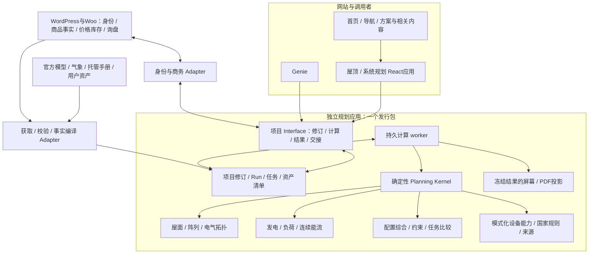

# 新规划系统的架构设计

2026-10-22。责任：Codex。依据用户当期要求，**整体重新设计规划架构**。现有实现用于行为与反例取证，产品身份、核实资料及业务事实用于迁移；旧页面、请求结构、计算公式、状态与存储不构成新架构的保留条件。本文件是研究后采用的设计方向和待实现合同，不是已部署软件。

## 1. 研究结论与采用的路线

建立**独立规划应用与确定性领域内核组成的模块化单体**。一个Python发行包运行短请求Interface和持久计算worker；几何、发电、负荷/储能、电气和系统综合是包内Module。React/TypeScript规划界面、Genie和WordPress通过同一个项目Interface工作。Woo继续负责商品、账号/价格/库存与询盘，规划应用负责项目、计算与证据快照。

这一选择从实际依赖得出：组件布局改变组串，逆变器端口限制改变电池配置，电池功率/SOC改变削峰和备电，模式/控制器又改变允许拓扑。新内核必须联立判断这些条件。现有“几个端点返回数值再在浏览器拼方案”的结构不承担这种推导。

### 三种方案的比较

| 方案 | 可取之处 | 本项目需要承担的代价 | 判断 |
| --- | --- | --- | --- |
| WordPress持有所有规划状态，PHP编排多个Python计算Interface | 账号及商务衔接直接，可用自定义表和持久任务实现正确事务 | 仍需新建完整revision/run/证据/编排；物理迭代与状态权威分置PHP、Python，调用者容易再次承担顺序与一致性 | 技术上可行，本次不采用为规划权威 |
| 独立规划应用与内核，同包HTTP+worker | 计算、依赖版本、任务与结果集中；多个入口共享相同Interface；内部Module进程内组合 | 新增规划持久库、身份/商务Adapter、备份恢复责任 | **采用**；符合现有数据和实际计算依赖 |
| 几何、PV、储能、选型分别部署微服务 | 适合已证明的独立扩容、团队或隔离需求 | 大型时序/拓扑跨网传递，必须解决分布式版本、重试及补偿；当前一核上增加部署没有独立扩容收益 | 保留未来实测热点提取的可能，初期不拆 |

独立审查比较了相同三种路线，推荐第二种，并给出Interface及反例，见[架构挑战](https://github.com/AssassinFlash/de-linker/blob/4e43a3332e9a15024ae3a58658d437a58c48dc59/docs/research/2026-10-22-roof-experience/hardware-study/architecture-challenge.md)。采用模块化单体是当前设计决定；不意味着后续性能和运维已经验证。

## 2. 应用关系和事实权威

用户2026-10-22明确选择一个统一工具。本文“独立规划应用”描述规划服务与WordPress的职责边界；面向客户，屋顶布局与系统配置属于同一应用、同一项目。住宅/工商业及客户身份不造成两套前台工具。详见[统一产品决定](PRODUCT-STRUCTURE.md)。全欧洲为目标，逐国气象、方法和设备/规则依据进入同一计算上下文。



| 数据 | 唯一权威及新系统的处理 |
| --- | --- |
| 商品身份、SKU、属性与手工商品事实 | Woo；英德共用英文事实源与语言映射。派生能力库不得成为第二份可手工维护的商品注册表 |
| 厂商能力及适用条件 | 核到具体型号、端口、模式的托管原件；核实记录回到权威工程事实，编译为不可变能力发布包 |
| 价格、库存、账号审批、询盘 | Woo现行状态。与物理能力分开；不把价格/库存变化写回历史工程结果 |
| 场地、屋面、负荷、目标与用户确认 | 规划项目的已提交revision；浏览器编辑缓冲不是已保存事实 |
| 一次推导与报告 | 固定依赖的run及其不可变Assessment/artifact；不以下载时的“最新”重新选择设备 |

屋顶规划是可独立完成的任务；住宅和工商业是需求模板及方法适用域。它们不再各自持有一套屋顶/发电/储能真相。已知容量、既有系统或仅储能项目也可进入同一项目模型，不强迫每个客户重画屋顶。

## 3. 新领域对象

这些对象重新定义，不沿用现有ResidentialInput、CommercialInput或BatteryChoice形状：

- **Project / Revision**：场地、资产、需求和确认过的假设；revision不可变，修改使用expected_revision检查冲突。
- **Site / RoofSurface / ArrayLayout**：WGS84及本地米制CRS、外环/孔/障碍、真实尺寸与来源、组件身份及位置、建筑坡度和安装姿态。坐标变换与方位约定必须显式。
- **LoadProfile / WeatherSeries**：原始资产hash、时间轴、时区/DST、功率或区间能量、计量位置、缺失/外推策略；不能把净购电当总负荷再次扣PV。
- **DeviceConfiguration**：设备、端口、模块/串栈/柜、控制器及附件组成的具体拓扑；商品行只是最终商务映射。
- **CapabilityFact / EvidenceDocument**：物理量、模式、持续/最大/限时峰值、条件、证据SHA、物理页、型号列、文档修订与核实记录。
- **Goal / Constraint / Assessment**：客户所求任务、必须通过的约束、通过/失败/未知及其原因。可行性与推荐排序分开。
- **RunManifest / Run / Artifact / Handoff**：固定输入和依赖的计算、任务进度、冻结结果/文件以及商务交接回执。

实际数据准备度也已读取，而非假定既有夹具代表运行：106件英文商品的Woo源有2,482条图值，实际feed有610条；备电输出、电池充放电上限和条件存在关键投影缺口。数量包括展示字段，不等于缺75%的必要参数。详见[源数据、实际feed与夹具的逐项研究](data-readiness/README.md)。这个证据支持重建事实编译与条件模型，不能以取消来源校验解决。

### 设备事实由带条件的能力图表达

能力图是领域数据结构，初期用结构化记录与引用保存，**不要求图数据库**。节点包括设备、端口、串栈、柜和控制器；关系包括串联、并联、连接、控制、必需附件和模式化放行。

量纲与含义必须同时存在：有功kW、视在kVA、DC峰值kWp、名义/可用kWh不能只靠字段名或单位字符串猜；连接容量、安装容量和净注入限制也分别建模。连续电流、最大电流和故障电流是不同能力。

本轮原表给出的设计约束包括：

- GW80K + GW61.4的一般兼容记录不自动证明备电模式；电池功率与双端口电流限制不能由80kW交流铭牌覆盖。
- ETA的额定备电、10秒峰值和有外部供能的旁路分别表达，还要联立所配电池输出能力。
- ESA的并机数绑定拓扑、控制器、并网/离网、STS与地域条件；不设一个脱离工况的max_parallel。
- SAJ模块串联增压但工作电流不相加，BC2的故障电流不能作为可交付电流；多串附件数量需要对应接线依据。

详见[17份原件、物理页与原表核对](https://github.com/AssassinFlash/de-linker/blob/74aa66b921dfad70af92fe909663dfcf62978f92/docs/research/2026-10-22-roof-experience/hardware-study/README.md)。未得到的条件保留未知，不能为让模型可算而制造默认能力。

## 4. Module划分与小Interface

| Module | 隐藏的复杂性 | 对外需要理解的合同 |
| --- | --- | --- |
| Project Workspace | revision、所有权、run、资产、保存与恢复 | 创建/修订/提交/读取/报告/交接；幂等、权限与版本冲突 |
| Planning Kernel | 几何、发电、负荷、设备与控制的联立推导 | 固定项目+固定上下文 → Assessment或有类型的NeedsEvidence；纯计算，无网络/邮件/商务写入 |
| Site & Array | CRS、屋面拓扑、障碍、安装方式及排布 | 组件不越界/进孔/重叠，组件ID和数量贯穿全链；精度与来源随结果保留 |
| Energy & Dispatch | 辐照/电气路径、连续SOC、损耗、控制、备电、能量来源 | 时间及计量边界固定；能量/功率/SOC守恒；目标不可行或方法越域明确返回 |
| System Synthesis | 候选拓扑、串MPPT分配、电池配置、模式与附件、比较 | 先资格和任务可行，再按明确目标比较；搜索预算/剪枝和未覆盖范围记录 |
| Evidence & Policy | 商品事实编译、原件、模型适用域和国家/电网规则 | 一个已验证、版本化、可重放的发布包；相关缺证据不能变为通过 |
| Project Store & Jobs | 原子事务、持久工作、租约、重启、幂等、产物发布 | 提交成功才返回引用；旧worker不可覆盖新领取结果；短事务，不在锁内跑计算 |
| Report / Commerce Adapter | 同run的呈现、SKU映射与当前Woo检查 | 读报告不重算；交接有幂等ID和回执；工程BOM与商务差异不静默丢失 |

真实变化才设seam：官方几何来源与人工资产、PVGIS与录制夹具、WP与协议夹具是实际Adapter差异；纯几何/储能函数不全部包成HTTP调用或空接口。

外部Interface的语义草图：

```text
create(seed, verified_actor, idempotency_key) -> ProjectRef
revise(project, expected_revision, changes, verified_actor, key) -> RevisionRef
evaluate(revision, verified_actor, key) -> RunRef
read(project | run, verified_actor) -> ProjectView | RunView
render_report(run, locale, format, branding_ref, verified_actor, key) -> ArtifactJobRef
prepare_handoff(run, candidate, intent, verified_actor, key) -> HandoffRef
```

actor来自服务端身份验证，不接受浏览器自报user_id。evaluate返回持久run引用只表示已受理；客户和Genie无需知道先调哪个计算器。选中不同硬件、改变几何或假设要有新的revision/派生选择记录，不能直接改冻结BOM。

### 传输、身份与资产

浏览器以同源WordPress窄网关进入规划Interface；它验证WP账号或受控访客会话，再以受限服务凭证传递主体和动作，规划服务自身仍核查项目归属。客户端自报user_id、project_id或一份客户端BOM均不作为授权事实。账号审批继续只由WP决定，不在规划库复制密码或账号审批状态机。访客归属依靠受控会话和认领协议，不把一个页面nonce当成所有权。

网关只转交短命令/状态读取，计算已进入持久队列后即返回run引用，不保持PHP长请求。长时序和报告按授权资产引用读取；UI先取概要，再按需取图表窗口，不把所有候选的全年数据一次灌入浏览器。Interface合同有schema版本，领域对象不直接暴露数据库行。

上传先得到私有asset引用，记录原始字节hash、类型、大小、来源与解析状态；解析失败不破坏原件。文件名、第三方URL或用户给出的“已验证”标签都不是内容事实。获取、解析和模型输入校验分阶段执行；清洗后的派生资产与原始文件可相互追溯。实际配额和超时来自后续容量实验，本文不编造限制值。

## 5. 计算模型与验证策略

新内核消费真实时间轴、母线/端口图、模式化能力及控制策略，返回逐时能流、候选拓扑、约束证据与缺项。数学参考求解器可用于可行域/上下界验证；实际控制重放另有角色。**完美预知调度可行，不等于厂商控制器能实现。** 模型角色、假设和精度均进入manifest和结果。

模型采用以下分工，具体参数和实现以方法研究与基准核对为准：

1. 几何与排布产生实际组件身份及安装几何；电气分配不能隐式增片。SMA式有条件Polystring等接法由厂商合同决定，不将“每坡独占MPPT”当普适定律。
2. 气象/辐照到阵列/逆变器输出，声明远近遮挡、排间模型和损失边界。PVGIS默认损失不能与后续设备模型重复扣；典型年与安全电压用设计极值分开。
3. 负荷与PV对齐后连续推进SOC，按AC/DC路径计效率，区分PV与电网充入、初始未知能量；午夜和任务边界不能免费补能。
4. 硬件离散配置和控制条件进入同一计算。设备满足容量但不足功率、缺附件或工况放行时，不能成为该任务的已验证候选。
5. 国家规则按电压域、安装/注入/连接功率语义和文档版本评价；结构/消防/并网审批不在证据范围时，保留明确待核项。

更详细的官方方法、独立MILP/账本/手算以及官方BatteryStateful物理对照由[深入计算研究](https://github.com/AssassinFlash/de-linker/blob/0b37a330219645bd1701b4c2174784931e87e604/docs/research/2026-10-22-roof-calculation/method-study/README.md)承载；各模型适用域、现行标准目录与三国原文由[工程研究](https://github.com/AssassinFlash/de-linker/blob/768cc73e921d3b07afd5548d51c43f47b2e5fc5c/docs/research/2026-10-22-roof-europe-precedents/engineering-study/REPORT.md)承载。本轮方法研究实际完成17条参考运行记录，以及官方PySAM 8.0.0 BatteryStateful的4项有限物理检查；硬件研究读17份原件，工程研究核了模型、现行标准目录及德/荷/法的代表性原文。它们不等同整套生产系统或各国所有现场验收。

### 候选综合与“更好”的含义

同一项目先定义目标、硬约束及客户确认的优先级，再生成有来源的离散拓扑；检查兼容、数量、组串/端口、持续/峰值、模式、控制器和完整附件。对必要事实不足的候选记录缺项，不把未知算作不适用的物理证明，也不把它与已通过者混排为最佳。

几何已确认的组件数固定。若电气求解要求改片数/分区，只返回明确变更方案，由新revision重新计算布局和产量。削峰、自用与备电共享同一电池状态和功率预算，不能三个独立计算各自使用完整容量后拼起来。

候选的实际控制策略在同一负荷/PV/气象边界重放，报告任务满足情况、不能满足的时间段、实际削峰/能流及主要限制。可用解析上下界和参考优化器剪枝；仅当边界对该适用域有效时才据此排除。求解超时/预算耗尽要返回已找到结果及未完成的搜索范围，不能冒称无解或全局最优。不同目标的候选保留可理解的取舍，不以未说明的权重合成万能分数，也不增加回本期。

## 6. 版本、任务和三条独立状态轴

run manifest固定项目revision、原始及清洗资产hash、CRS/时间语义、实际能力发布包、国家规则、气象请求及响应、模型/solver/代码版本、配置与假设。固定hash之后执行时还去读“当前文件”，不构成版本固定；worker必须读到对应不可变字节或返回version_unavailable。

三条状态分别展示和控制动作：

| 状态轴 | 含义 |
| --- | --- |
| 任务执行 | queued/running/retry_wait/succeeded/failed/cancelled，含阶段、重试、资源原因 |
| 工程判断 | 在明确任务与条件内可行、需要补证、不可行、方法越域；附每项通过/失败/未知 |
| 与当前项目的关系 | 对应当前revision、输入已改变、或有新证据可重算；历史结果仍保留原依据 |

其他回执也单独记录：访客私有/账号归属、项目是否已持久化、报告是否生成、商务是否确认。一个HTTP成功或saved布尔值不能代表全部状态。

修改输入后，旧run可以完成和保存为历史，但不能挂到新revision。下载历史PDF明确保留其输入；生成另一语言或Logo的PDF只重做呈现，不重选设备。任务完成却得出“缺关键设备资料”，是成功完成的调查结果，不能显示成工程已通过。

## 7. 初期持久化与计算运行

只读实测当前VPS为1CPU、约4GB，Python3.12.3及SQLite库3.45.1可用；无Node、Redis或Postgres二进制。已有服务内存状态和采样时间存于[资源记录](architecture-study/raw/runtime-resources.json)。未在生产安装、写测试库或运行负载试验。

初期采用同机SQLite WAL作为规划持久Implementation、内容寻址的持久资产目录，以及一个重计算worker。HTTP进程只做短验证、读写和任务提交；重活不占PHP→上游的长请求，也不依赖进程内BackgroundTasks作为持久队列。[FastAPI官方后台任务说明](https://fastapi.tiangolo.com/tutorial/background-tasks/)区分小任务与重计算所需的更独立执行方式。

选择SQLite具有条件：所有读写进程同机、事务短、外部请求和计算不持写锁、写入可排队。WAL允许读写并行但仍只有单写者，且要求同机共享内存；[SQLite WAL说明](https://www.sqlite.org/wal.html)与[适用场景](https://www.sqlite.org/whentouse.html)都明确这些限制。新架构没有把SQLite称为无限扩容方案。

任务采用租约、领取代次/fencing和幂等发布；执行语义按可能重复处理设计。重试旧任务时，只可复用对应版本的阶段资产；超时worker返回后也不能覆盖新领取者。取消请求在发布时再次检查。数据库与产物发布、备份恢复及GC需配套，不承诺未经证明的exactly-once。

数据库最小记录包括projects、revisions、runs、jobs、assets、artifacts、handoffs及幂等/所有权记录。大时序和PDF不塞进Woo post meta，文件与数据库清单用内容hash对应；数据库快照与被引用资产必须能一致恢复，WAL库备份使用数据库备份机制而非只复制主文件。

**代价与升级触发：** 单机故障、持久文件备份、资源争用、写锁等待和长任务公平性都需要实际验证。若实测写争用、多个计算节点或可用性要求超出此模式，则将Project Store & Jobs的Implementation迁到Postgres/独立工作设施。Postgres的锁定扩展有官方[SELECT文档](https://www.postgresql.org/docs/current/sql-select.html)；是否采用它由实测需求决定。当前不增加Node SSR、Redis或多个数据库进程来定义“现代”。

## 8. 已执行的架构研究实验

[lifecycle_reference.py](architecture-study/lifecycle_reference.py)是独立研究代码，使用临时SQLite WAL和实际两个连接，结束删除临时库；不引用现有应用存储，没有真实物理计算或用户资料。结果在[lifecycle-results.json](architecture-study/lifecycle-results.json)：

| 场景 | 已观察结果 |
| --- | --- |
| 同revision重复提交 | 返回同一个run，没有第二个任务 |
| 计算期间4500改6000 | run保留4500；当前revision变更；旧run不能成为当前方案；旧标签页覆盖被拒 |
| worker租约过期、另一实例恢复 | 同一持久run被新代次领取，旧worker迟到写入被拒；新结果成功，旧历史导出不变 |
| 任务正常完成但缺备电依据 | 执行succeeded，工程needs_evidence，当前完整方案动作被拒 |
| 取消后旧worker完成 | 结果发布被拒 |
| 两个实际连接同时领取 | 两个领取者只有一个取得任务 |

这证明这些生命周期合同在所试单机研究模型中可以实现；不是授权/租户隔离、断电恢复、生产吞吐或工程准确度验收。实验的SQLite版本为本机3.54.1；生产3.45.1只做可用性读回，仍需部署前夹具测试。

## 9. 浏览器、Genie和站点入口

React应用使用集中状态/显式动作管理编辑缓冲、已提交revision、当前run和历史结果，后台项目是持久权威。语言影响呈现，国家影响物理/并网适用规则；德语小数与单位归一在同一字段合同中验证。[React官方reducer说明](https://react.dev/learn/extracting-state-logic-into-a-reducer)支持将分散状态转移集中表达，但框架能力不能替代本项目的状态与交接验收。

屋顶直接入口首先显示任务和成果预期；自动、尺寸/图纸、地图输入各有可编辑路径，来源失败时保留工作。项目修订后旧结果明确过期。地图不负责电气放行，前端不复制选型规则或自行批准BOM。

首页重点能力区、桌面/手机导航、住宅/工商业/安装商页面及相关产品/内容，将入口指向同一项目工作流，携带已知目标与产品上下文；仍沿既有网站视觉体系实现所需导流变化。详细信息架构与操作目标见[综合方案](README.md)第9–11节，具体原型在方法和架构研究后验证。

Genie通过受同样权限约束的项目Interface读取或提交明确动作，调用确定性内核；自然语言不能创建厂商放行、覆盖工程未知或绕过版本检查。现有生产模型通道不改变。

## 10. 保存、报告与商务交接

保存先在规划库持久化，再返回project/revision/run和归属回执；访客的受控私有主体与账号归属分别处理。登录认领需要验证当前WP主体与原访客占有关系，不复制另一套密码体系；保留期限和资产配额需在产品与容量验证中明确，本文不臆定天数。

报告只投影已冻结Assessment，artifact另记模板、语言、Logo版本和hash。PDF失败不回滚已完成计算；重试只生成文件。新事实更正可标记受影响历史run，但不能静默改旧PDF和旧询盘。

商务handoff固定run、候选、拓扑、BOM/附件、待核项与SKU映射。WP以可信服务调用读取，再按Woo当前商品、价格/库存及账号规则生成Solution draft或询盘。浏览器只提交引用与意图，不自报一份已批准清单。

跨规划库/Woo不假定有分布式原子事务。以handoff_id作幂等键、持久发送记录及回执；超时先查回执，避免重复询盘。准备handoff和实际提交询盘是不同命令，后台重试不能替客户产生未经提交的真实邮件。商品变化返回具体差异；若替换影响能力，重新修订和计算，不能商务侧静默删必要附件。

## 11. 重建次序与可以迁移的内容

1. **定义新合同与独立基准。** 以本轮方法/原件/国家研究和反例建立领域及计量语义、能力图、模型适用域、生命周期不变量；不从旧端点反推新需求。
2. **建立新应用骨架。** Project Workspace、修订、持久工作、资产与报告引用；以研究实验验证的状态合同为依据重新实现生产质量代码，增加权限、配额、备份和故障测试。
3. **实现事实编译与计算内核。** 从Woo和核实原件发布能力包；组合地理/阵列、发电/负荷、电气/设备/控制与国家规则。研究MILP和官方物理模型用于校核，实际控制策略另验。
4. **接入新规划界面及各调用者。** 屋顶/已知容量入口、修改恢复、来源与结果；Genie、账户、PDF与商务使用同一Interface和run。
5. **迁移与发布。** 迁移SKU/商品映射、核实资料、旧输入/报告等内容和数据；无法还原足迹的历史方案保留出处，不能追认为新模型通过。新旧不在同一项目中混算。经本地、评审站、部署读回和命名用户路径验证后，再扩大首页/导航导流。

原始产品/文档、核实事实、天气录制与审计反例可迁移；当前选型函数、平面/住宅/商业请求结构、客户端方案拼接、post-meta保存和报告重算不作为新架构保留接口。数据库/代码删除和生产切换不是本研究阶段动作。

迁移边界以项目明确选择新运行版本为单位。新系统在隔离实例完成参考案例和全链消费后，再以显式切换启用；不让新UI调用一半旧选型或旧报告下载时隐式重算。切换前核旧方案数量、资产/商品映射和可恢复性，发布包保留schema兼容与回滚方案；恢复旧代码不能把已知错误的旧算法追认为新项目的验证来源。

## 12. 仍须完成的实证

新架构需要用实际项目规模测量候选搜索、全年/15分钟计算、峰值内存、任务等待与锁争用；控制策略可执行性、原始能力曲线、标准付费条款、逐SKU国家依据和现场布局/遮挡精度仍需补证。独立数值对照、域外失败、权限/跨项目隔离、备份恢复、worker故障、英德桌面/手机操作及商务交接都要通过。

这些是正确性的证据要求。用户允许重做架构和由Codex负责，不等于已执行的验证范围可以扩大；研究可行方向、已跑实验和待验证生产能力在本文分别记录。
