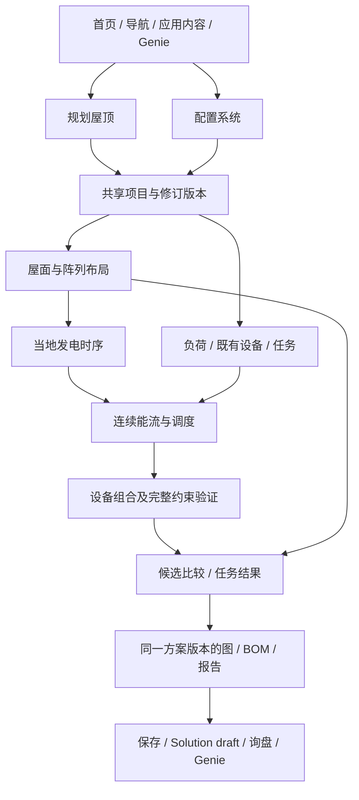

# 屋顶规划与系统选型：可信性结论及重构方案草案

日期：2026-10-22，Asia/Shanghai。状态：已取得可复跑审计证据；本文件是供评审的方案，未获产品定稿、工程准确度或上线验收通过。业务代码与生产数据未改动。

所属地图：[地图：屋顶规划与系统选型可信性审查及重构路线](https://github.com/AssassinFlash/de-linker/issues/548)。用户明确：老板只认可屋顶工具这个想法；本轮先审查、再给方案，允许方案采用破坏性重构。

## 1. 对用户两个问题的回答

**想法能够落实。** 可建立面向欧洲住宅与工商业项目的屋顶布局、发电规划及系统选型能力，给屋顶独立入口、独立成果，再让用户选择继续系统设计。Easy PV、SMA、K2、OpenSolar 的官方资料提供了实际先例。实现这个目标不要求先建成完整结构、静力和施工审批系统；但会影响布局、发电、设备能否完成任务的参数，必须进入计算。

**当前实现不能直接承担这个目标。** 已有可复跑反例表明，部分系统建议违反组件数量、连续能量、可交付功率、配件完整度或自身放行约束。增加 Commercial 的地图入口、放宽德国坐标、补来源说明，都不能修复这些问题。住宅与工商业选型方法、共享项目数据和结果发布条件需要一起重构。

这不等于每一项现有计算都错。投影与平面几何、部分单位换算、未知兼容不放行的机制、PVGIS调用和报告渲染已有可用基础；需要逐模块独立证明后复用。**旧规格解释实现的来历，现有测试检查已有行为，两者都不能单独证明系统能够完成客户输入的任务。**

## 2. 证据与本轮边界

| 证据包 | 已执行内容 | 固定记录 |
| --- | --- | --- |
| 系统计算与选型 | 14项问题、21层方法信任清单、16组边界/正向控制/故障注入；协调者再次成功运行全部探针 | [计算审计及可复跑程序](https://github.com/AssassinFlash/de-linker/blob/62e8036aa7e092d10f6b52b9e7e24f4d07973c7b/docs/research/2026-10-22-roof-calculation/README.md) |
| 用户路径与下游消费 | 20个cookie-free页面入口采样；独立线上快照实例、真实浏览器操作；12项路径问题，区分浏览器、请求和源码证据 | [体验研究分支](https://github.com/AssassinFlash/de-linker/blob/b12377a5884c95ed96464ca4b9762c3ff89b8009/docs/research/2026-10-22-roof-experience/README.md) |
| 成熟模式与欧洲依赖 | 11组Apify取证，官方操作、方法、数据与许可；逐URL核验，失败独立记录 | [外部研究报告](https://github.com/AssassinFlash/de-linker/blob/ad782cba169d298a49c8e0794e941328f9aab611/docs/research/2026-10-22-roof-europe-precedents/REPORT.md) |

代码基线 `123aea571e80b5b1ba756816914ba86408866ba5`；与根工作树 `2b2e8267` 的差异未涉及引擎和工具代码。引擎探针使用该代码、仓库商品夹具与已发布兼容合同；合成天气、时间序列或故障注入明确标注，不能当成某真实客户或某真实地点的实测。设备原始PDF本轮未逐份重取，现场误差与全欧洲现行规则也未验证。

本地浏览器实例 `r549` 从2026-10-22线上快照加载，EN/DE各有实际观察，视口含1440与390；没有把有限状态覆盖写成全部四组合均验收通过。外网航拍与PVGIS本次失败；为审查下游，成功流程使用了单独标记的仓库录制天气缓存，算法、商品与放行合同未替换。没有提交真实询盘、注册、发信或改生产。

项目规定的Claude研究/审读未完成：真实Claude通道OAuth失效；未将其他模型路由冒称Claude。三个研究报告都记录了此限制。当前证据足以确认下列程序反例，尚不能声称完成全部指定评审。

## 3. 当前系统为什么会这样选择

住宅主链是：屋顶或手填kWp → PVGIS年/月产量；另用HTW住宅规则给容量上限 → 在兼容电池里挑容量 → 逆变器按AC功率接近PV容量等自定规则排序 → 组串与物料清单 → 报告。住宅自给率/自用率使用参考家庭查表，不消费该项目的PVGIS产量。

工商业是另一条路径：CSV最后一个数值列 → 假定15分钟采样 → 每日削峰面积 → kW/kWh设备筛选。没有CSV时给厂商经验范围。当前商业路径没有屋顶/PV时序与联合自用调度，因此切到Commercial后屋顶入口消失。这是现有范围及接口的结果，不能推出工商业不适合屋顶规划。

HTW的容量**上限**不是“最佳电池容量”；最接近PV kWp的逆变器AC kW不是通用最优性证明；厂商系列配对放行不等于每种模块数量都能完成指定功率、备电和控制目标。现有规则在这些层级之间缺少严格区分。

## 4. 影响可信性的已确认发现

以下编号对应详细研究，存在同一根因的重叠，不将其相加为互不相关的缺陷总数。

| 项目 | 已执行结果或明确缺口 | 对重构的直接要求 |
| --- | --- | --- |
| C1，屋顶与BOM | 19片×460W=8.74kWp，完整住宅流程变20片/9.2kWp；产量仍按8.74kWp | 组件身份与数量贯穿布局、组串、产量、BOM；无法接入时返回不可行或显式修改建议 |
| C2/C3，商业削峰 | 跨午夜连续事件最低需85.1kWh，却给42.6kWh；补能检查另有损耗不守恒 | 连续SOC模拟及统一能量边界，午夜不重置；输出无法满足的时段 |
| C4，屋面孔洞 | 100m²外环减16m²内孔，应84m²，解析成两面共116m²并对孔排组件 | 外环/内孔/障碍的拓扑模型、面积与排布不变量 |
| C5，负荷导入 | 672条逐小时数据按7天处理；追加row_id可被当成功率；重复时间可通过 | 明确列、单位、时间戳、时区、间隔、缺失与计量边界，导入预览确认 |
| C6，联合计算 | 加入1000kWp及自用目标，CSV分支返回完全相同结果 | PV、负荷和同一电池时序共同计算，所有被接受目标都有消费者 |
| C7，实际系统功率 | 仓库商品夹具与当前兼容合同下，75kW需求仍选中该组合；夹具所存电池放电上限为67.5kW，合同亦注明不能达逆变器满功率，输出仍显示80kW。原PDF本轮未重核 | 校核PCS、电池、BMS、端口、数量和工作条件下的实际可交付功率；原PDF逐字段复核 |
| C8，多柜放行 | 按功率1柜通过，按容量增到3柜后绕过缺失并联依据的门 | 任何数量或配置改变均重新验证全部相关约束 |
| C9，自给率 | 合成低产量2208kWh/年、负荷4000kWh/年，仍给61.84%–71.84%；无损上限仅55.2% | 自给率、自用率与发电及负荷使用同一能流；参考表作为带范围的对照 |
| C10，平屋顶 | 仅贴面网格；缺安装倾角、南向/东西向、行距、障碍及遮挡；屋面姿态与组件姿态混用 | 建筑几何与阵列安装几何分开，参数真实影响数量和产量 |
| C11/RX09，来源足迹 | 屋顶多边形、组件位置、影像/面ID及排布假设未完整随报告保存 | 逐面、逐数组的来源与版本进入项目、屏幕和PDF |
| C12，备电 | 输入10kW关键负荷维持半小时，仍可选夹具备电额定5kVA设备且现有门全通过 | 分开验证备电能量、持续/峰值功率、相与隔离/切换及附件；kW/kVA分型 |
| C13/C14，完整系统 | 必需配件从feed移除后仍有完整放行建议；电池电气字段改变不影响堆叠 | 必需配件成为完整度条件；端口和电气配置有可执行语义 |
| RX01/RX12，入口意图 | roof深链仍落住宅表单；商用4个具体CTA均落默认住宅 | 路由携带任务、项目与目标，进入后兑现入口承诺 |
| RX02–RX05，输入与恢复 | 灰图仍提示点屋顶；逗号小数可静默变0°；角度错误被说成越出德国；屋顶172.5kWp下游被100kWp门拒 | 统一校验及错误类型、数据源失败恢复、跨步骤适用范围一致 |
| RX06–RX08，状态与保存 | 改4500为6000后报告仍4500且可下载/保存；访客被告知“已存账户”，链接实际到登录 | 输入版本绑定结果、旧结果失效；访客/账户保存状态清楚且可恢复 |
| RX07/RX10/RX11，编辑与业务链 | 几何修订/恢复合同不足；商品加入草稿不携带完整项目；账户/Genie重算缺原始屋顶快照 | 项目、方案与商品清单分开建模，保存及交接完整方案身份 |

报告确实已有PVGIS、HTW、手册链接和部分假设；空邮编校验也能工作。问题是部分方法本身不适用或错误，依据、适用域、状态与消费者又没有形成闭环。增加说明只有在方法正确之后才增加可信度。

## 5. 可行性：成熟模式支持什么

- [Easy PV东西向FAQ](https://help.easy-pv.co.uk/books/faqs/page/how-can-i-model-an-east-west-panel-layout)明确支持商业平屋顶的`No mounting`布局：方向、间距、倾角进入性能计算，不输出支架物料。它证明布局与性能规划有独立价值，现阶段可将结构验算另列待核，但布局、行距、障碍和遮挡不能一起省掉。
- [OpenSolar电池方法](https://support.opensolar.com/hc/en-us/articles/12382460685455-How-OpenSolar-Models-Battery-Energy-Storage)公开逐时能流、可用容量、功率、效率、控制策略及AC/DC耦合；[SMA multiuse](https://manuals.sma.de/SDesign/en-US/14444632075.html)在同一电池SOC范围协调自用与削峰。它们为方法重构提供先例，并不替本站每个硬件组合背书。
- [SMA导入说明](https://manuals.sma.de/SDesign/en-US/14318222475.html)明确周/年、采样间隔和功率/能量单位。短样本可以有清楚标记的外推，不应发明“没有全年就全部不能算”的门槛。
- K2的多屋顶项目、Easy PV尺寸建模、OpenSolar校准图纸提供影像缺失时仍能完成屋顶规划的路径。具体页面和本轮原文快照在外部研究报告。

欧洲应分别发布：可建立项目、可显示影像、可取得真实屋面、可计算当地发电、设备/国家规则已验证。荷兰LoD2.2/1.3、瑞士3.0区域、波兰LoD2旧数据和England DSM等已有明确差异；足迹、影像、DSM和真实分坡屋面不能互换。人工尺寸/校准图纸流程可统一建设，自动化按地区验明并保留来源、日期、许可。

可行性还有待测量的条件：真实几何误差、设备关键数据覆盖、负荷样本、国家规则、运行时/内存/并发、外部源配额与运维成本。本轮没有据此编造固定工期、零费用或全欧洲统一精度。

## 6. 产品关系：独立屋顶入口，共享一个项目

建议产品同时支持“先规划屋顶”和“已知容量，直接配系统”。客户只想知道屋顶可如何布局时，不要求年耗或电池信息；已知PV容量或既有系统的客户，也不强迫重画屋顶。用途标签用于收集需求和筛选适用设备，不再决定某个物理模型是否存在。

“独立”意味着入口、任务和成果可单独完成；系统设计仍依赖真实阵列、气象、负荷与设备事实。只传一个kWp会丢失布局、组串和来源，复制两套计算则会产生版本分歧。

## 7. 需要替换的数据与计算结构

| 模块 | 输入/输出合同 | 最小独立证明 |
| --- | --- | --- |
| 项目与证据 | 项目ID、修订；国家/坐标/时区；逐字段来源及日期；事实/用户输入/假设/待核；产品、方法和数据版本 | 同一输入快照可重放；修改产生新版本；任何下游能定位其使用版本 |
| 屋面几何 | 多栋、多坡、外环/孔、障碍/禁布区、尺寸、坡度朝向、原始模型ID | 面积与孔守恒，几何有效，不将LoD1平顶当实测 |
| 阵列布局 | 实际或明确标记的参考组件、安装方式/倾角/朝向、边距/行距/通道、模块位置和唯一ID | 不越界、不重叠、不进孔；数量=图上实际组件，安装几何与发电几何一致 |
| 发电 | 逐阵列天气、年份、损耗、远近遮挡范围、模型版本、时间粒度 | 总产量等于阵列和；片数/kWp一致；历史年际范围与模型不确定度分别解释 |
| 负荷 | 原始文件hash、列映射、单位、时区/间隔、缺失处理、总负荷或净购电、既有PV | 时间/能量语义可核；避免将现有PV重复扣减；小时天气不能伪装成15分钟实测 |
| 储能与调度 | 设备可用容量、充放电约束、SOC初末边界、效率、待机损失；自用/削峰/备电优先级；可执行控制策略 | 连续SOC与能量守恒；不可行任务有时段证据；不把多目标容量简单相加 |
| 设备及完整度 | 逐端口电气数据、MPPT/组串、温度、连续/峰值能力、数量、并联/固件/控制器、附件和国家依据 | 先全部硬约束通过，再参与比较；资料缺失保留未知，数量变更重新验证 |
| 比较与报告 | 客户任务、方案满足程度、基线/方案差异、排序准则和未满足项、图/BOM/依据 | 不把一项容量通过称整套通过；同一方案版本贯穿屏幕/PDF/保存/业务消费 |

硬约束包括可布组件、组串电压/电流、可交付功率、SOC与备用容量、兼容及必需配件。目标比较在这些约束之后发生。初步方案可枚举并验证有依据的离散硬件组合，再比较任务表现；是否需要优化器、如何剪枝和确定容差，须经真实样本与性能验证后定，不能先指定一个未经证明的“最佳”排序键。

## 8. 计算方法应怎样落地与公开

对采用AC接口功率的简化能流，先明确：`E_next = E + η_charge × P_charge × Δt − P_discharge × Δt / η_discharge − E_aux`。`E`是电池内部可用能量（kWh），充/放电功率是AC接口功率（kW），`Δt`以小时计，`E_aux`仅指本步折算到同一储能边界的损耗。来自AC母线的辅助耗电进入母线负荷平衡，不能再无条件扣一次电池能量。PV、购电、电池放电与负荷、充电、上网/限发的平衡必须闭合；设备拓扑和计量边界不同需显式变换。公式是验证合同草案，不能把一个通用效率替代所有SKU的真实性能。

至少应校核：

1. 逐时间步SOC、充放电功率及设备工作边界；初始/终端SOC策略显式，不能让周期边界免费提供能量。
2. 自给率与自用率来自同一能流；区分PV充入电池、从电网充入的电以及转换损耗，避免用电网充电虚增太阳能贡献。
3. 硬件离散取整或型号改变后重放调度。满足容量却不满足功率、缺并联或备电能力的候选不得获得完整系统结论。
4. 时区、夏令时、闰年、缺点和气象/负荷粒度对齐有明示方法。削峰结果的时间精度与输入分辨率一致。
5. 备电使用关键负荷时序或清楚定义的恒定功率/时长；分别验证能量、持续/冲击功率、可供相、隔离/切换和附件。

来源台账每条记录至少包含：规则类型、公式或阈值、单位、适用对象/地区/条件、文档发布者与版本、页/条款、URL、获取日期、证据状态、使用该规则的计算步骤。界面数字可展开到这一层，PDF保存同样的快照。

现状引用了HTW、PVGIS、厂商手册，也有VDE-AR-N 4105/4110、IEC相关阈值经二级材料或计算表进入规则。**本轮未逐条核实其现行标准原文和具体国家适用性，不应宣称现系统已按所有这些标准设计。** 重构需要区分法律/并网要求、厂商限制、研究方法、产品排序偏好和规划假设；规格里标`verified`或附一个URL不能替代这个核查。

## 9. 新手操作与结果预期

建议流程草案：

1. **开始前看懂成果。** 展示一个可查看的屋面布局、片数/kWp、发电及后续系统报告样例；说明所需资料、地域数据状态和仍需现场确认的内容。此处不要求账号。
2. **选择地点及屋面输入方法。** 自动模型、地图描绘、尺寸建模/校准图纸清楚区分；先确认建筑，图源失败时保留已做工作并给替代路径。
3. **确认和编辑屋面。** 多栋/多坡命名；增删/修订、撤销重做、保存恢复；倾角/朝向有图示和单位，自动与手填来源可区分。
4. **形成阵列。** 明确实际/参考组件，平屋顶安装姿态，障碍/禁布区/通道与行距；先自动铺，再可调整；图上操作立即标记受影响结果待重算。
5. **取得独立屋顶结果。** 布局图、组件数/kWp、逐面依据；可用时给当地发电和未计算的遮挡范围。用户可保存/导出，或继续系统配置。
6. **继续系统任务。** 新建/改造、现有PV、负荷导入或带范围的粗筛；说明有完整时序能得到什么、只有年耗能得到什么。商业多目标明确优先级。
7. **比较并交接。** 展示满足/不满足的任务、原因、实际设备、BOM及依据；修改后原结果过期，确认新版本后再保存、下载或加入草稿。团队收到项目版本及待核项。

数字输入统一EN/DE小数、正负与范围处理；无效值不能变成0。字段旁给物理含义、单位及例子，功率kW、能量kWh、峰值kWp、视在功率kVA分别处理。错误指出字段、原因及下一步。手机需要精确输入/定尺和选择列表等辅助方式，不能只缩小桌面画布。

可信信息分层：首层显示结论与下一步；数字旁显示关键输入和假设；方法面板给公式、适用域及文档页；导出包保留详细结果与版本。若某段证据不足，保留已经成立的屋顶/发电成果，同时说明后续系统还缺什么；不能用一句总免责声明覆盖所有计算。

## 10. 重点展示的站点入口

以下为位置与行为建议，客户名称和最终EN/DE文案待原型/文案评审，不直接发布。

| 位置 | 具体建议 | 必须承接的上下文 |
| --- | --- | --- |
| 首页 | 在现有hero之后的首个重点能力区展示真实布局/结果预览，直接开始屋顶并可看样例；既有hero静态视觉按裁定保留 | 进入屋顶任务，无需先找住宅表单 |
| 主导航与手机菜单 | 在既有Plan with Linker组下让屋顶规划和系统配置同级可见，并各用一句用途说明；不再只藏在配置器描述里 | 可直接开始相应任务，键盘与触控都可达 |
| 工商业/住宅方案与安装商页 | 容量未知导向屋顶，容量已知导向系统；削峰/自用/备电入口携带真实目标 | 项目类型、目标、已有项目ID；不能四个CTA都落默认住宅 |
| 相关产品页 | 逆变器/储能适配位置提供继续已有项目或验证本型号；没有屋顶上下文时不虚填容量 | 明示选中产品、已知约束；后续验证可拒绝不适用型号 |
| 相关博客/知识内容 | 在讨论屋顶面积、平屋顶排布、发电、系统容量的段落后给结果预览与入口 | 保留内容主题，显示能完成的任务 |
| 结果、账户及Genie | 修改/继续同一项目，查看依据、保存和询盘；访客与账号持久化状态一致 | 项目、输入/结果版本、BOM及原始足迹，避免暗中重算覆盖原结果 |

首页、导航、相关页面沿现有设计体系实现，仅将明确列出的导流变化纳入变更台账；工具应用内可重做。入口扩大应与可信能力发布绑定。

## 11. 与站点业务的联动合同

- **Solution draft / Lösungsentwurf：** 商品行仍按Woo原生承接；另外关联方案快照，明确是整套加入还是部分加入、用户是否改过数量。没有完整附件时不能显示整套齐备。
- **询盘：** 保持访客可发询盘的现有业务；团队收到商品清单、方案版本/报告、屋顶来源和待核项，而非从几个SKU反猜客户项目。无需增加付款、订单或履约。
- **账户：** 保存后能恢复编辑同一项目；过往报告保持原计算版本，更新数据后可显式生成新方案。访客保存要说明保留范围并验证认领流程。
- **Genie：** 只读取/操作当前项目与明确版本，以同一确定性引擎计算，模型不能编造设备数值或自行宣布兼容放行；模型通道维持项目既定裁定。
- **报告/PDF：** 同一计算快照生成，含图、BOM、设备及检查/待核项、来源、假设和版本，可带Logo；不增加回本期。

## 12. 替换、保留与旧结果处理

| 处置 | 对象与理由 |
| --- | --- |
| 替换 | 当前每日面积削峰、项目产量与HTW百分比分离拼接、可隐式增片的组串交接、容量与铭牌主导的任务通过、遗漏附件仍完整放行 |
| 重建接口 | Residential/Commercial各自持有状态、只传kWp的屋顶交接、未版本化的保存/报告/草稿消费 |
| 独立证明后复用 | PVGIS适配与缓存、有效的投影/平面算术、严格单位/未知值机制、兼容规则组合机制、同Report渲染、现有地图绘制库与WP/Woo/LC/WindPress通道 |
| 继续核实 | 商品电气/备电/堆叠/并联及附件的原文数据；国家/DSO规则；场地温度、安装规则、阴影与模型误差 |

破坏性重构可以替换内部合同和模块，不等于删除用户历史方案。迁移应保留原始输入、结果与文件；旧结果标注其生成版本和局限，原屋顶足迹缺失时说明无法恢复。新引擎计算生成新版本，不静默覆盖旧PDF或将旧结果追认为通过。

当前版本在这些已证实路径修复并验明前，不应扩大“可信工程选型”的宣传。是否临时限制具体结果动作，应根据部署同版读回和影响范围另作明确发布决定；本轮未自行关闭线上工具。

## 13. 落实顺序与验收门

顺序按依赖提出，不是已经批准的实现票。

1. **锁定任务和证明合同。** 明确屋顶独立成果、住宅/商用各任务、硬约束、结果状态、标准/设备来源台账和共享项目版本；把本轮反例纳入独立验收基准。
2. **证明计算链。** 先完成几何/布局与片数一致性，再发电/负荷时间语义、连续能流、实际硬件限制、配件及离散组合重算；拿人工可解例和选定独立方法核对。
3. **用原型验证操作与表达。** 新手从入口到独立屋顶结果，再继续系统；同时验证导入、无法计算、数据源失败、修改与恢复，不只展示成功截图。复刻成熟模式，证据不足的地方给设计理由。
4. **验证全链消费。** 保存、账户恢复、Genie、草稿、询盘预览、报告/PDF均使用同一方案版本；设备/数据变更后的失效行为能复现。
5. **按已验能力发布及重点导流。** 通用人工流程与地区自动能力分别验收、分别列覆盖；首页/导航/内容入口随可交付能力启用。先本地，再评审站，最后部署与读回。

不可缺少的验收集：

- 本轮所有错误反例得到正确结果、明确不可行或精确缺项；修复不能仅改警告或把场景删掉。
- 几何含凹面、内孔、障碍、多栋多坡、南向/东西向、边界组件和零组件；用实际尺寸或人工复核校对，误差容限有来源。
- 时间含跨午夜、连续多日、空/满SOC、损耗、不同采样率、DST/闰年、缺失重复；输入变化必须改变相应物理结果。
- 设备含同容量不同功率、备电不足、配对未知、必需配件缺失、多柜、型号/数量变更；资料不足不能显示通过。
- 物理与业务不变量：能量守恒、功率/SOC边界、组件数和kWp守恒、图/BOM/报告/下游版本一致；独立可复跑，不用实现自身作为唯一答案。
- EN/DE、1440/390、键盘/触控，新手与关键成功/错误/恢复状态；客户文案经过初稿→对抗评审→定稿。
- 每个公布自动能力的地区有真实成功、无模型、过期、失败和人工恢复夹具；负载/内存/响应/外部配额有测量。
- 部署前备份，发布后读回与命名用户路径验收；本地通过、CI绿、方法有出处均不能单独等同上线验收。

## 14. 仍须通过证据或实际评审决定的事项

方案已经能回答可行方向与重构骨架；以下尚未锁定，不在本文件中伪造决定：具体算法/库和外部参考基准、各数据条件下的准确度与容差、逐SKU关键事实和控制策略、首批自动地区/规则、实际资源成本、工具最终名称与原型细节。它们记录在地图对应决策与原型票里；不能让当前UI、旧规则或竞争者有一个按钮就替代这些判断。

用户最新提出的系统选型根基问题已经影响路线优先级：先把“客户任务→可行约束→实际运行→设备→一致的结果”证明成立，再建设展示和导流。这个顺序允许重做现有结构，也保留屋顶工具作为站点重点能力的产品目标。
