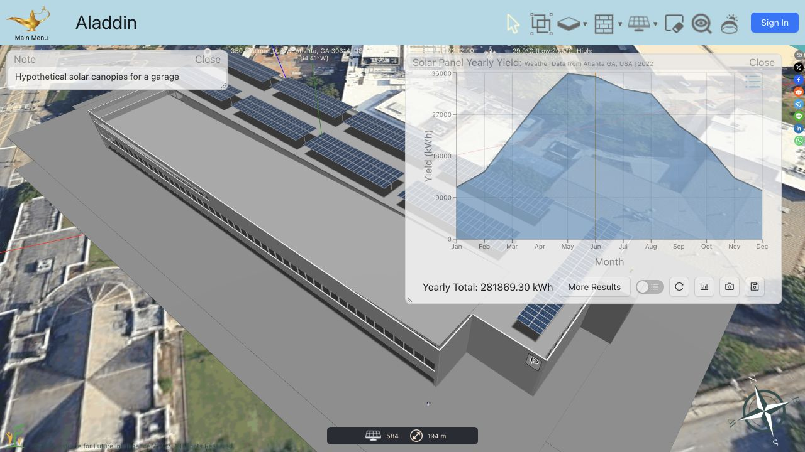

# 已取得并实际运行的软件：屋顶规划与系统选型的复刻依据

取证：2026-10-22。本次只取得和研究软件，不修改产品代码或生产。用户明确没有 Trace 账号，要求继续找可直接使用的软件。

**已找到并实际使用无需账号的完整三维应用 Aladdin，取得可编辑项目、两次年发电分析的 CSV，以及固定版本的完整源码 ZIP。** 另已在 PV*SOL online 完成真实组件与逆变器/组串配置求解。获取软件这一步已有实物，不再以概念原型代替软件运行。

## 1. 直接可用的入口与实走边界

| 软件 | 已完成的实际操作 | 当前具体边界 |
| --- | --- | --- |
| [Aladdin](https://institute-for-future-intelligence.github.io/aladdin/) | 无账号打开完整应用；载入官方 Solar Canopy Over Garage 示例；渲染 584 片组件的三维建筑；完成 4 代表日和 12 代表日两次年发电分析；分别保存原生 `.ala` 与 CSV。 | 本轮在线 UI 为 **2.0.7**。公开示例位于 Atlanta，不能当作欧洲现场/真实 SKU/并网或结构验证。该软件的教育/研究定位与计算方法见下文。 |
| [PV*SOL online](https://pvsol-online.valentin-software.com/#/) | 无账号设置 BDEW G1、80,000 kWh/year、92×Trina 460 W、10°/180°、屋面支架和 GoodWe 品牌；点击 Get best configuration 得到真实逆变器与组串方案。 | 年模拟前出现 reCAPTCHA，本轮停在此前；没有该项目的年发电、自用或储能结果。配置界面有警告图标，未解释前不得把求解结果视为工程放行。 |
| [Trace archelios PRO](https://www.archelios.cn/online/bin/Archelios-Online-Login.php?lang=cn) | 进入真实应用登录界面；确认试用按钮通向申请/注册，取得官方安装、版本变更和工作流资料。 | 没有访客设计入口或本轮可用账号。没有取得商业程序安装包、进入设计器或运行 Trace 计算；未注册或联系名片人员。 |
| [SMA Sunny Design](https://www.sunnydesignweb.com/sdweb/#/) | 已核当前官方匿名权限表。 | UI 未实测；不把“官方可匿名”写成“本轮已运行”。 |
| [K2 Base](https://base.k2-systems.com/#/dashboard) | 已取得两份官方原生 PDF 说明，内含荷载/报告实例片段，实际核查了三个关键页面。 | 没有本轮生成的结构计算、压载/BOM 或可编辑 K2 项目。 |

## 2. Aladdin 实际结果、项目与数据

主菜单路径：`Examples → Solar Energy → Photovoltaic Solar Power → Solar Canopy Over Garage`；分析路径：`Analysis → Solar Panel → Analyze Yearly Yield`。应用未要求账号即可执行上述本地设计与分析。已用 Open Local File 重新载入本轮导出的十二代表日 `.ala`，再次运行得到同样的 281,869.30 kWh，584 片组件也正确恢复。[重开后的原始界面](coordinator/raw/aladdin-project-reopened-result.txt)、[截图](coordinator/screens/aladdin-project-reopened-result.jpg)。本地项目流程已实走；云项目/账号功能未验证，出现过 Firebase 权限日志，不据此声称全部在线功能免账号可用。



| 对照 | UI 中的设置 | 本轮软件显示的年量 | 实际导出 |
| --- | --- | --- | --- |
| 官方示例原有设置 | 4 Days per Year；2 Times per Hour；Approximate；0.5 m 网格 | 282,262.24 kWh | [原生项目](coordinator/artifacts/linker-study-aladdin-garage.ala)、[4 行 CSV](coordinator/artifacts/yearly-pv-yield.csv)、[截图](coordinator/screens/aladdin-yearly-result.jpg) |
| 同一几何、地点与其余参数 | 只通过 UI 将 4 Days per Year 改为 12，重新 Analyze Yearly Yield | 281,869.30 kWh | [原生项目](coordinator/artifacts/linker-study-aladdin-garage-12-days.ala)、[12 行 CSV](coordinator/artifacts/yearly-pv-yield-12-days.csv)、[截图](coordinator/screens/aladdin-yearly-result-12-days.jpg) |

两次相差 -392.94 kWh（约 -0.1392%）。这是同一示例的**采样敏感性**，没有真实观测值或独立完整基准，不能称“误差只有 0.14%”。[机器可读核查](coordinator/runtime-comparison.json)确认两份项目几何及其他 world 设置相同；CSV 汇总与 UI 数值在显示舍入范围内一致。[核查脚本](coordinator/check_runtime_artifacts.py)可在本机重新运行。

关键发现：四行 CSV 是 Jan/Apr/Jul/Oct，数值和为 94,087.41243357198；软件年量为该和乘以 12/4=3 后的舍入值。十二代表日的 CSV 有十二行，总和直接对应显示年量。**两次都不是 365 天、8760 小时的全年逐时模拟。** 图上年份 2022 与示例日期一并出现，不构成气候数据为该年实测数据的证据。

已取得的 **2.0.6 源码**也能定位到月间隔 `12/daysPerYear`、代表日、月数据加权、年度总量再乘 `12/daysPerYear` 的机制；CSV 本身不携带全部这些权重。源码全局默认为 12 代表日、每小时 1 次；**4 日/每小时 2 次是本次 Garage 示例的设置，不是软件通用默认**。导出器会省略等于默认值的字段，第二份 `.ala` 中没有 `daysPerYear` 是默认压缩，导入时会恢复。源码与 live 不是同一版本，只能说机制与实测一致，不能冒充同版重建通过。

这解释了我们的复刻目标：用户看到年量时，还必须能查到采样策略、气候来源、损失和计算版本。漂亮的年图和两位小数不能替代计算适用性证明。

## 3. 已实际取得完整源码，可以检查和改造

官方仓库：[Institute-for-Future-Intelligence/aladdin](https://github.com/Institute-for-Future-Intelligence/aladdin)。本轮取得固定 commit **`7b939ab115ca6d78bafc274b07e0bd9cbb5b36aa`** 的完整 ZIP，25,329,681 bytes，SHA256：

```text
1441ac0f978a12d2930d390e22c195b338f35cb64bb8005e3aacd6f437bfb40a
```

逐项对照公开 Git tree 的 1168 个跟踪文件，缺失/额外/Git blob hash 不匹配均为 0。未安装依赖、执行包脚本或声称本地已构建运行。ZIP 可由本地软件学习包取得，原始下载和校验在源码研究分支。

许可原文是 MIT，保留许可与版权声明即可按其条款使用、修改、分发。本轮没有完成所有三方依赖、模型、影像和品牌资产的单独许可清点，因此复用决策针对已核到的源代码，不把整个线上服务和所有资产笼统视为同一许可。[官方固定许可](https://github.com/Institute-for-Future-Intelligence/aladdin/blob/7b939ab115ca6d78bafc274b07e0bd9cbb5b36aa/LICENSE)

版本必须分开：固定源码内 `src/constants.ts` 为 **2.0.6**，`package.json` 为 **1.7.5**；本轮实际操作的线上 UI 和导出项目为 **2.0.7**。四个公开原生例子内部版本又为 1.8.9。没有把 package 版本、项目格式版本、源码 UI 版本和 live 版本当成同一个值。

机构将其定位为 CAD/CAE 教育与研究平台。它适合拆解三维对象、父子关系、组件阵列、交互编辑、排布与仿真呈现；该定位和源码可得本身并不等于适用于我们所有欧洲工程输出。[机构产品说明](https://intofuture.org/aladdin.html)

## 4. PV*SOL 的真实设备/组串结果

输入见上表，当前默认公共气候坐标为 52.5087°N / 13.43245°E；不是用户项目地址。实际组件型号为 **Trina TSM-460 NEG9R.28 Vertex S+**，92×460 W=42.32 kWp。倾角 10°、朝向 180°、Mounted-roof；shadowing/soiling 等默认值不能理解为已经完成遮挡/污损调查。

真实点击配置求解后返回 **2×GW20KLV-MT**；每台 `MPP 1: 2×8 / MPP 2: 2×8 / MPP 3: 2×7`，每台 46 片、共 92 片；dimensioning factor **105.8%**。只证明厂商工具在这些输入下返回了这个方案，尚未独立核验电网电压、温度窗口、端口电流、采购可用性和界面警告。不能直接带入我们的产品放行规则。[原始界面文本](coordinator/raw/pvsol-configured.txt)、[截图](coordinator/screens/pvsol-real-configuration.jpg)

界面 build `0.16.8591.27438 - 4361852`。年模拟被验证码拦住，未点击完成，不把 Aladdin 的发电量移填到本工具，也不把它写成光储联合仿真通过。

## 5. Trace 和商业平屋顶资料带来的具体依据

Trace 当前公开链路把三维规划/发电仿真的 **archelios PRO** 与电气设计校核的 **elec calc SOLAR** 串接。真实登录页本身展示了从 PRO 导入、直流组串/交流配电、原理图/BOM 的链路。官方 2026.0 更新说明也写了导入时保留组件/逆变器引用和系统结构。由资料证明的职责划分不能冒充我们已操作其商业设计器。[当前 SOLAR 说明](https://tracesoftware.cn/products-2/software-for-sizing-elec-calc-solar/)

中国 Free 页宣称 36 kWp；国际当前 Free 页宣称 9 kWp/project，存在地区/版本差异。它们都是账号申请路线，不把任一档说成可直接匿名跑全欧洲工商业项目。[中国页](https://tracesoftware.cn/archelios-pro/free-pv-design-software/#freeversion)、[国际页](https://www.trace-software.com/en/our-solutions/archelios-pro-free-free-pv-design-software/)

K2 两份已取得的报告材料能用于学习屋顶构造、支承面积、荷载组合、保温材料允许值、风载/标准输入的解释方式。K2 官网也明确列出向 archelios PRO、PV*SOL premium、Sunny Design 的数据转接。它们支持将屋顶安装结构与发电/电气计算通过项目数据衔接，而不是用一个面积公式同时宣布所有结果合格。[K2 官方工具页](https://k2-systems.com/en/digital-services/k2-base/)

## 6. 根据实物调整接下来的重建方式

已有足够依据开始**围绕成熟应用的真实实现研究和重建**；无需等待 Trace 账号，也不需要继续凭空发明屋顶编辑器。

1. **屋顶与排布：以 Aladdin 的实际三维项目和源代码为直接底本。** 先沿本轮 `.ala` 文件追到对象、坐标/父子关系、选中/编辑/撤销、阵列排布、遮挡采样与结果导出；判断可保留的模块和需剥离的教育/云服务功能。直接采用哪些模块仍需同版运行与回归，不先把整个应用塞进站点。
2. **设备和组串：以 PV*SOL 等真实工程流程对照，保留独立约束验证。** Woo 手工产品仍为本站产品权威；对实际组件/逆变器/电池，必须依据原厂资料、工况和端口合同检查。Aladdin 三维算例没有证明本站设备选型正确。
3. **光储与欧洲工商业：继续用独立能流、控制、国家包和工程报告验证。** 本轮只改变获取和学习依据的具体程度，不把美国车库示例或匿名 PV 方案变成全欧洲光储、静力或并网已经过关的结论。
4. **产品形态：入口可以独立，项目数据应共享。** Trace/K2 的实际分工和数据交接支持这个方向；后续操作原型应依据这些成熟状态、文件和真实默认值重做，再落实本站简化流程、站点入口与报告溯源。

此研究回答的是“是否能取得真实软件作为复刻依据”：**能，且已经取得并跑出了可保存、可回读的真实结果。** 它不等于整体重建实现、用户验收、计算精度与全欧洲工程范围已完成。

## 7. 资产索引

- 本目录 `coordinator/`：主线真实浏览器截图、原始 UI 文本、四份软件导出、对照检查及哈希。
- [固定 Trace 报告](https://github.com/AssassinFlash/de-linker/blob/5b37f7fbd7948370127185afcb404adce9aff5b8/docs/research/2026-10-22-trace-software-access/trace/README.md)：含 6 份官方 PDF 原件（38 页）、访问墙、教程和版本资料。
- 同类软件研究：[固定 alternatives 报告](https://github.com/AssassinFlash/de-linker/blob/039e12e3ac5f031f24be6508684149beefd51aeb/docs/research/2026-10-22-trace-software-access/alternatives/README.md)，含 30 项官方来源、K2 原件与已核关键页。
- [固定可复用源码报告](https://github.com/AssassinFlash/de-linker/blob/2c681c77e1433e2afcde8272250ef9d78c6640f4/docs/research/2026-10-22-trace-software-access/reusable/README.md)：含源码 ZIP 的获取/校验、MIT 原文、四个原生例子、采样方法定位和天气链。
- 全部研究工作树与分支相互隔离，不合并到产品。Apify 用于外部来源，Computer Use 用于实际应用；没有注册账号、接受商业试用协议、完成验证码、安装桌面程序或发送信息。
